# Nexus HRM

A role-based human resources demo built with ASP.NET Core 8 Razor Pages. It covers the day-to-day HR workflow end to end: people, leave, payroll, attendance, performance reviews and internal messages, with a different experience for HR, managers and employees.

This is a demo. All data lives in memory and resets whenever the app restarts, so you can click anything without consequences.

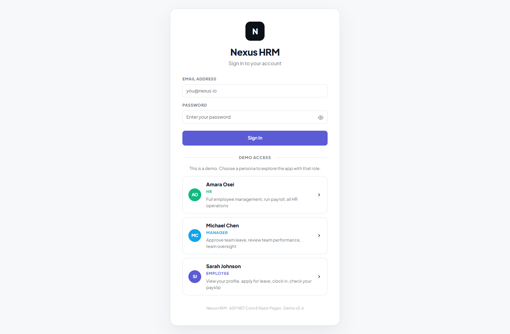

## Quick start

**Visual Studio 2022 (17.8 or later)**

1. Open `NexusHRM.sln`.
2. Press **F5**. The app opens at `https://localhost:63763`.

**Command line**

```bash
cd NexusHRM
dotnet run --launch-profile NexusHRM
```

If your browser warns about the development certificate, run `dotnet dev-certs https --trust` once.

Requirements: the [.NET 8 SDK](https://dotnet.microsoft.com/download/dotnet/8.0) or newer.

## Demo accounts

The sign-in page has one-click persona cards. You can also sign in with an email and password. Every employee has the email `firstname.lastname@nexus.io`, and the password depends on the role.

| Role     | Persona        | Email                     | Password        |
|----------|----------------|---------------------------|-----------------|
| HR       | Amara Osei     | `amara.osei@nexus.io`     | `HRAdmin123!`   |
| Manager  | Michael Chen   | `michael.chen@nexus.io`   | `Manager123!`   |
| Employee | Sarah Johnson  | `sarah.johnson@nexus.io`  | `Employee123!`  |

Employees added through the app can sign in straight away using their email and the password for their role.

## What each role can do

| Capability                         | Employee | Manager                  | HR              |
|------------------------------------|:--------:|:------------------------:|:---------------:|
| View own profile, payslip, reviews | Yes      | Yes                      | Yes             |
| Apply for leave                    | Yes      | Yes                      | Yes             |
| Approve or reject leave            | No       | Direct reports only      | Everyone but self |
| Clock in and out                   | Yes      | Yes                      | Yes             |
| See attendance                     | Own      | Own and direct reports   | Everyone        |
| Write performance reviews          | No       | Direct reports only      | Everyone but self |
| See payroll                        | Own      | Own                      | Everyone        |
| Run payroll, export to Excel       | No       | No                       | Yes             |
| Add or offboard employees          | No       | No                       | Yes             |
| Message HR                         | Yes      | Yes                      | n/a             |
| Message anyone or broadcast        | No       | No                       | Yes             |

These rules are enforced on the server for every request, not only hidden in the interface.

## Tour

### Dashboard

Each role gets its own set of figures: leave balance, hours this week and rating for employees, team and pending approvals for managers, headcount and payroll status for HR.

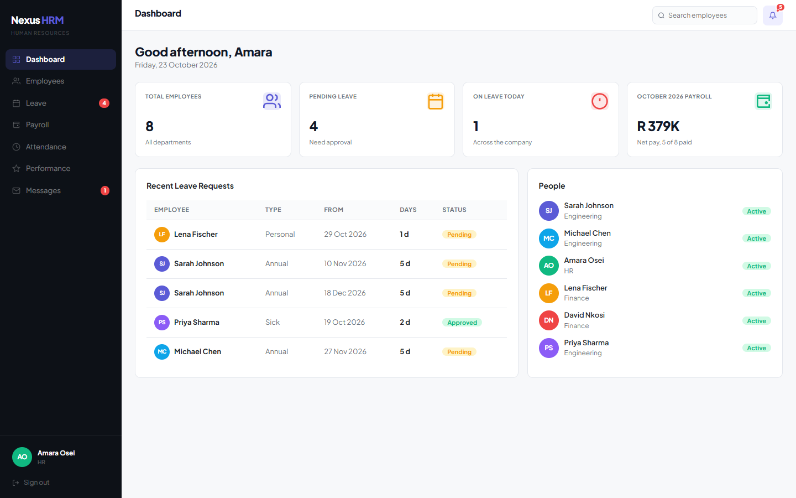

| Manager | Employee |
|---------|----------|
| 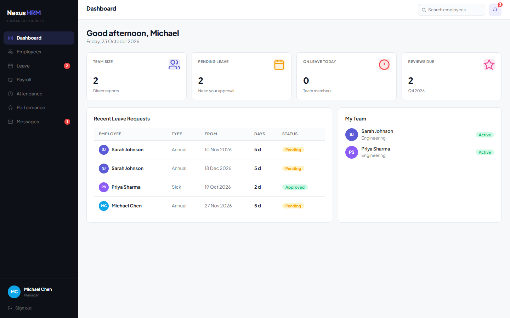 | 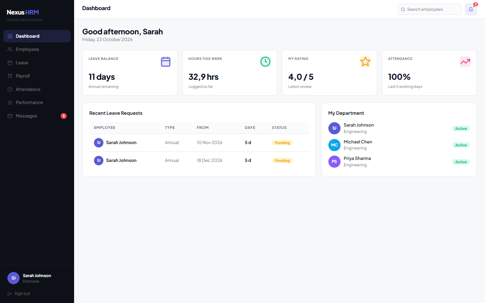 |

### Employees

A searchable directory with department filters. HR can add people and offboard leavers. Salary is only visible to HR and to the employee themselves.

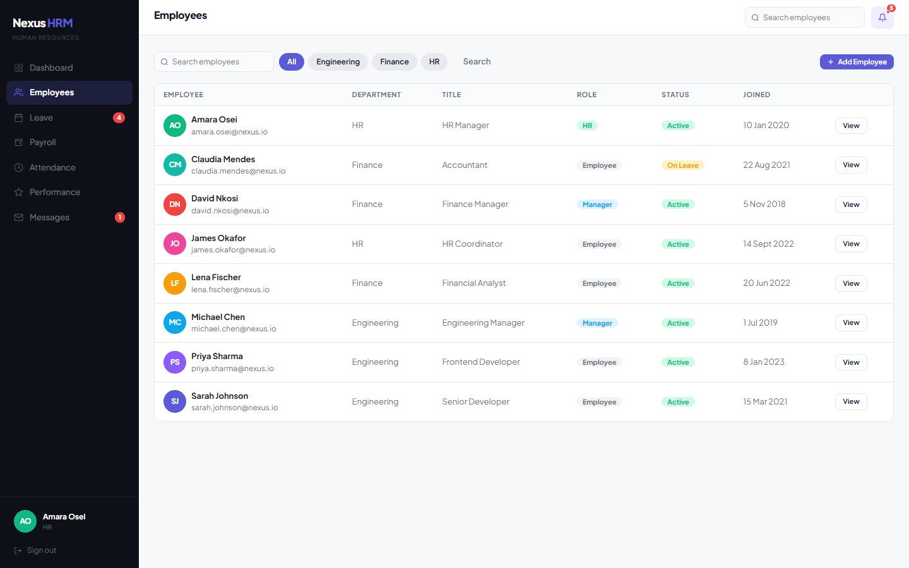

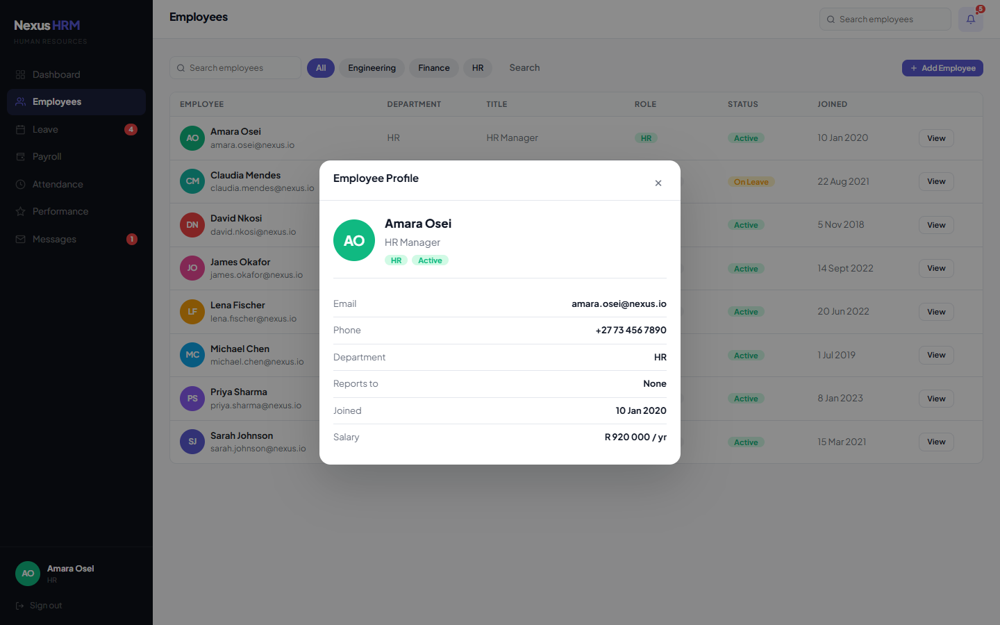

### Leave

Balances for annual, sick and personal leave with live usage. Requests are validated for weekends, reversed dates, overlaps with existing requests and available balance. Approvers only see the buttons for requests they are allowed to decide.

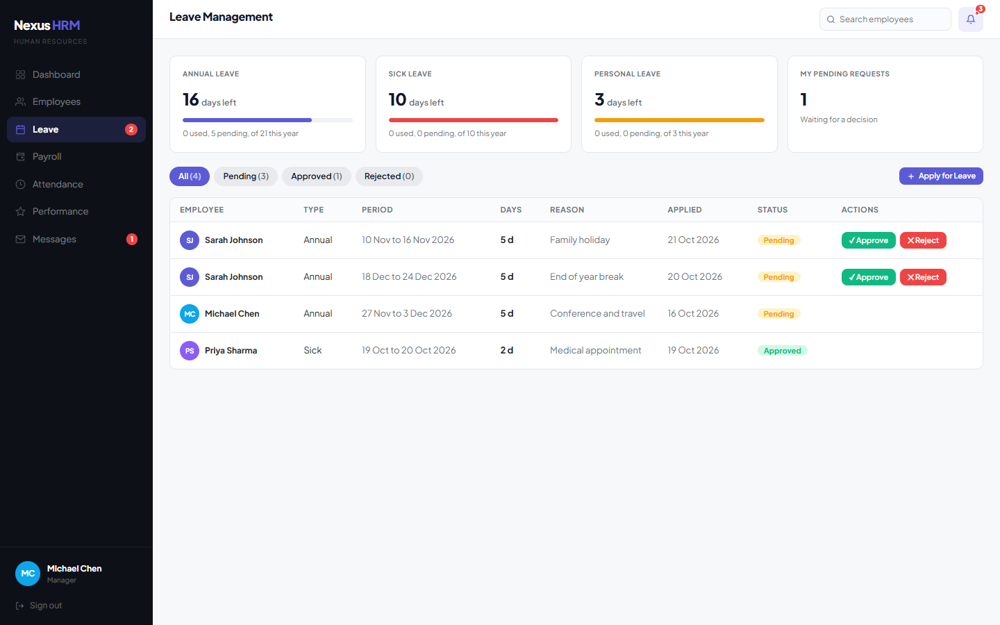

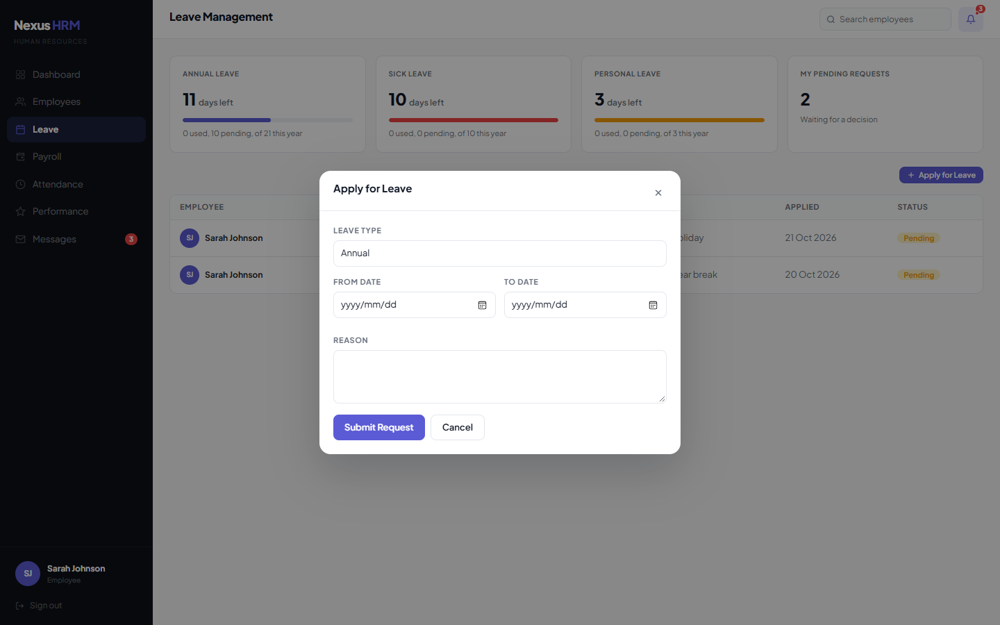

### Payroll

Monthly payslips with South African PAYE and UIF. HR gets totals, a progress bar for payments released, per-employee payment, a one-click run for the month, and an Excel export.

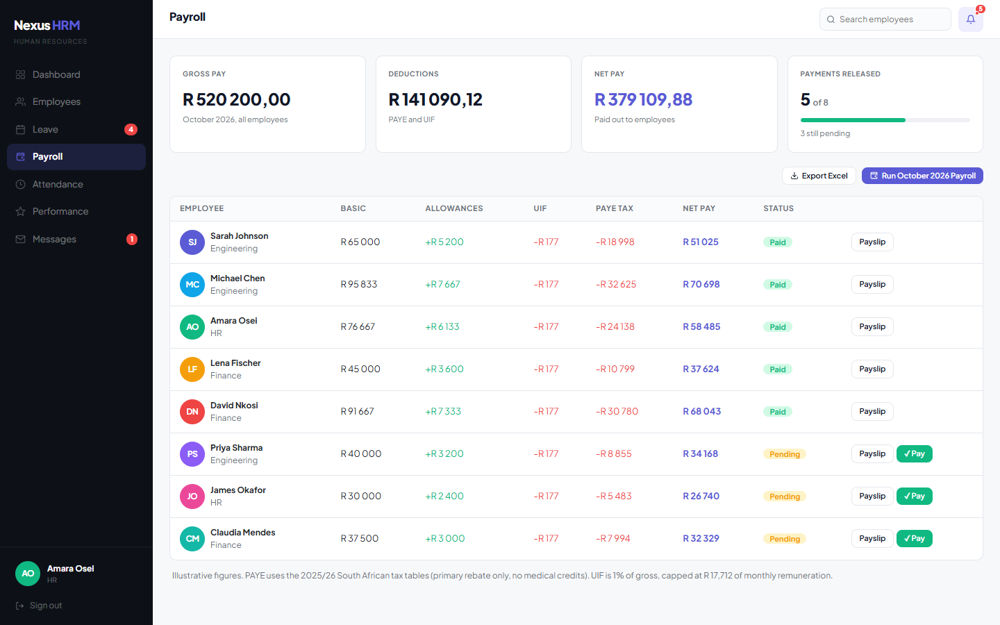

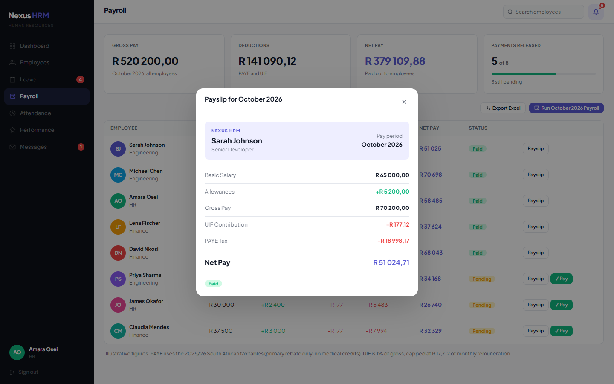

### Attendance

Employees clock in and out for the day. Managers and HR browse the last five working days by date.

| Employee | Manager |
|----------|---------|
| 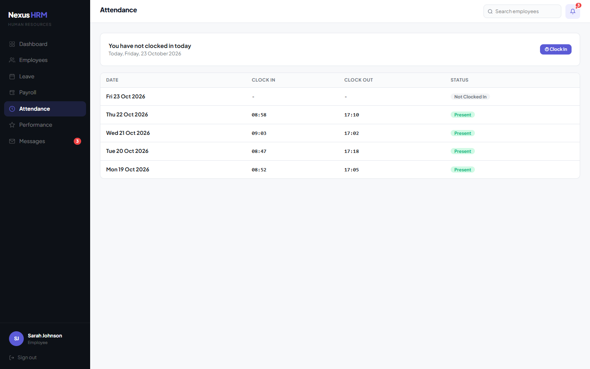 | 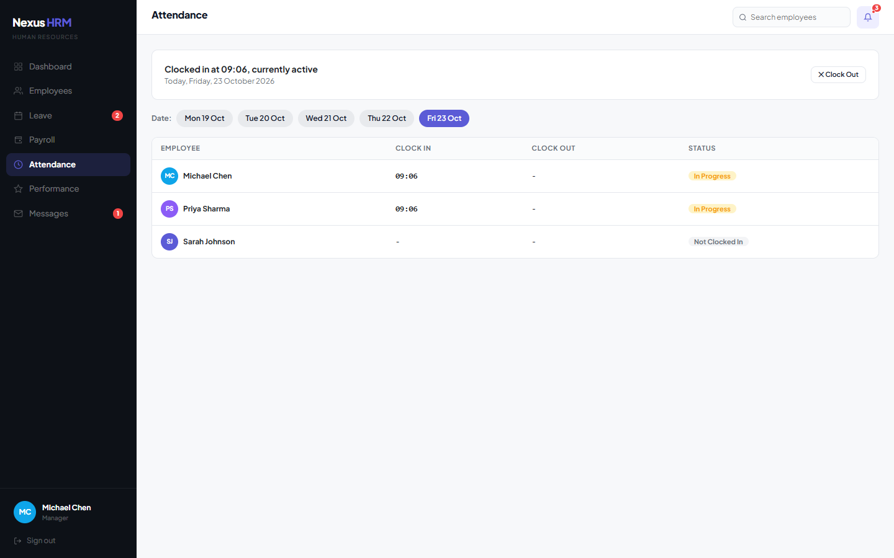 |

### Performance

Star-rated reviews across quality, communication, teamwork and initiative, with manager notes.

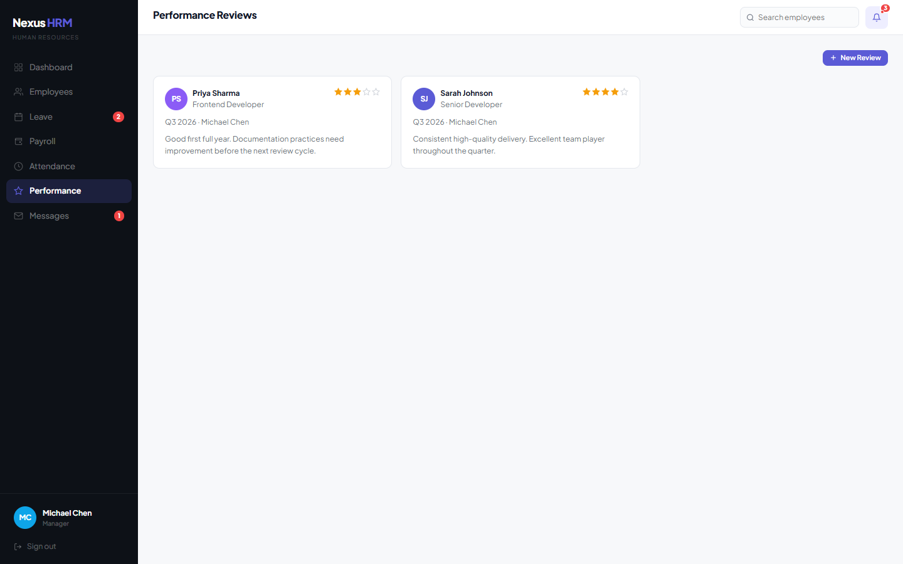

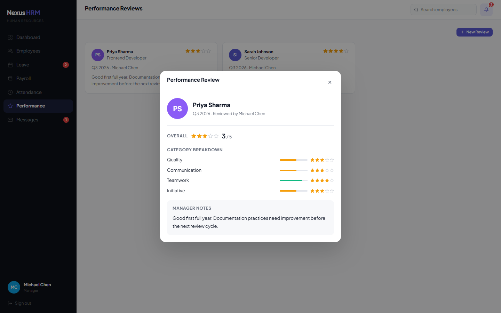

### Messages

An internal inbox. Everyone can write to HR. HR can message any person or broadcast to the whole company. Unread counts show in the sidebar and the notification bell.

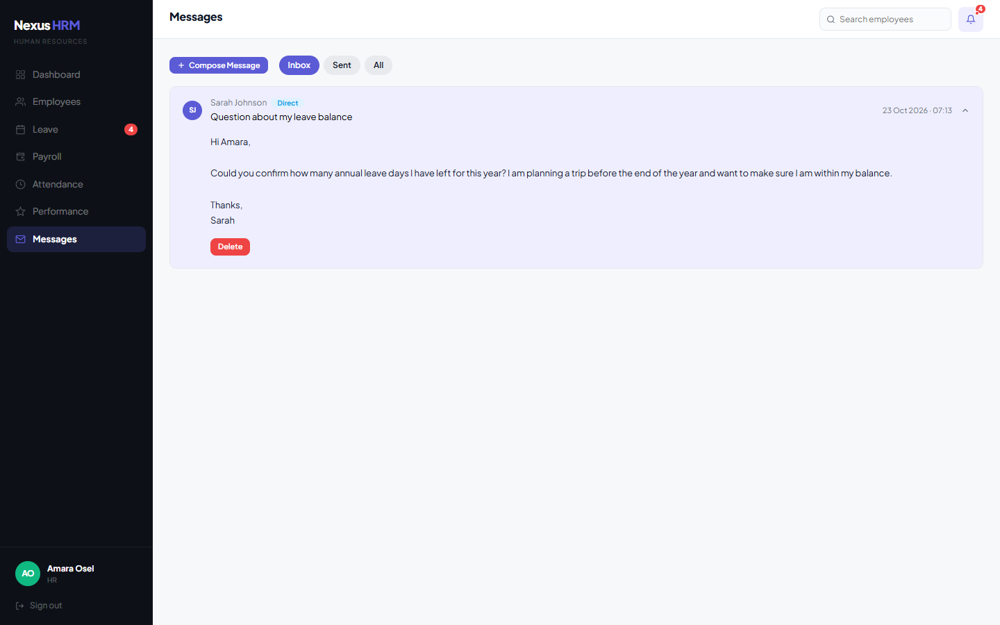

## Payroll calculations

The payroll maths lives in `NexusHRM/Data/PayrollCalculator.cs`.

- Allowances are 8% of the monthly basic salary.
- PAYE uses the 2025/26 South African income tax brackets and the primary rebate. Medical credits and other rebates are not modelled.
- UIF is 1% of gross pay, capped at a monthly remuneration of R 17,712.

The figures are illustrative and not a replacement for a registered payroll engine.

## Project structure

```
NexusHRM/
  NexusHRM.sln
  README.md
  docs/screenshots/            Images used in this README
  NexusHRM/
    Program.cs                 App start-up, session and Razor Pages
    Data/
      DummyData.cs             In-memory store, seed data and access rules
      PayrollCalculator.cs     PAYE, UIF and net pay
    Infrastructure/
      AppPageModel.cs          Base page: sign-in check, current user, flash messages
    Models/                    Employee, leave, payroll, attendance, review, message
    Pages/
      Account/                 Sign in and sign out
      Employees/ Leave/ Payroll/ Attendance/ Performance/ Messages/
      Shared/_Layout.cshtml    App shell: sidebar, top bar, notifications
      Index.cshtml             Dashboard
    wwwroot/                   Stylesheet and scripts
```

Every signed-in page inherits from `AppPageModel`. It looks up the current employee, redirects anonymous or offboarded users to the sign-in page, and serialises request handling so the shared in-memory data is never changed by two requests at once. Who may see or do what is defined once in `DummyData` (`VisibleLeave`, `CanDecide`, `VisiblePayroll` and friends) so pages and handlers cannot drift apart.

## Demo behaviour worth knowing

- **Dates are relative.** Seed data is generated around today's date, so leave, attendance and reviews always look current. On a weekend the demo treats the last working day as today.
- **Restart to reset.** Stop and start the app to return to the original data.
- **Sign-in is a demo mechanism.** Passwords are one per role and sessions are cookie based. There is no database or external identity provider.

## Tech stack

- ASP.NET Core 8 Razor Pages
- ClosedXML for Excel export
- Bootstrap 5 and a custom stylesheet
- Plus Jakarta Sans from Google Fonts
